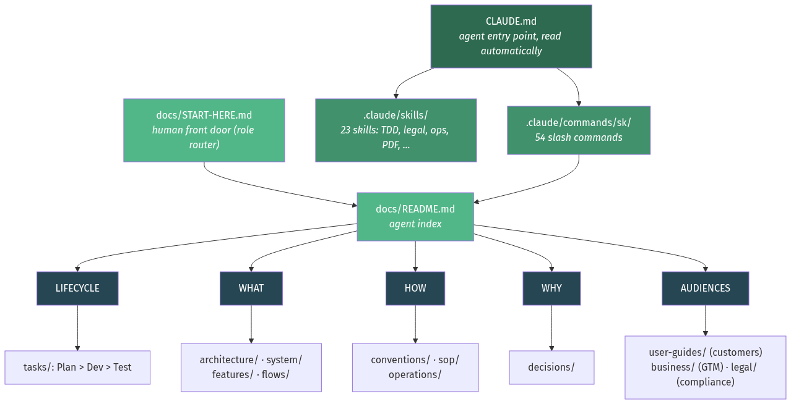
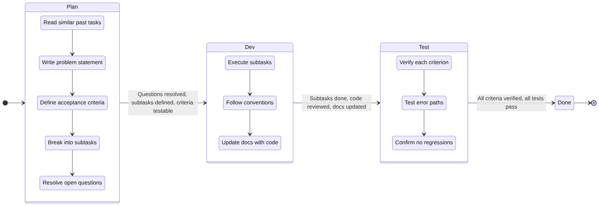
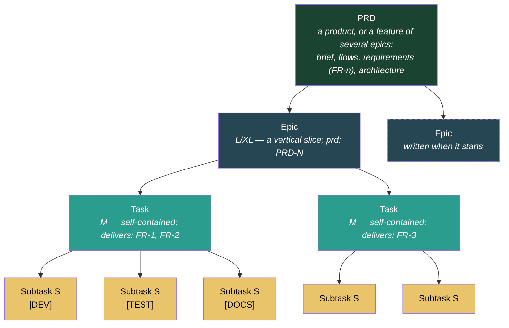
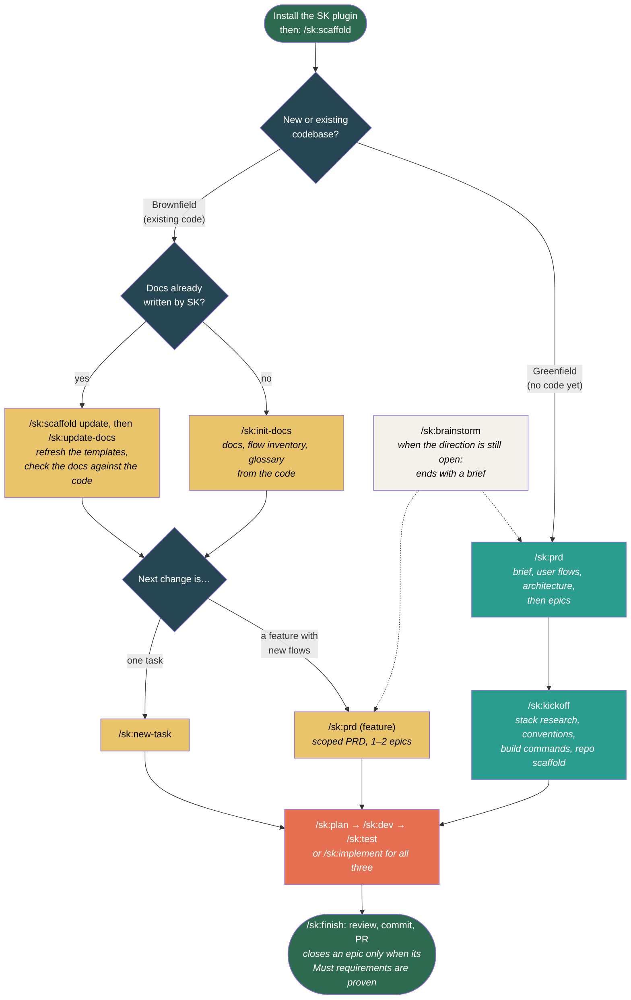
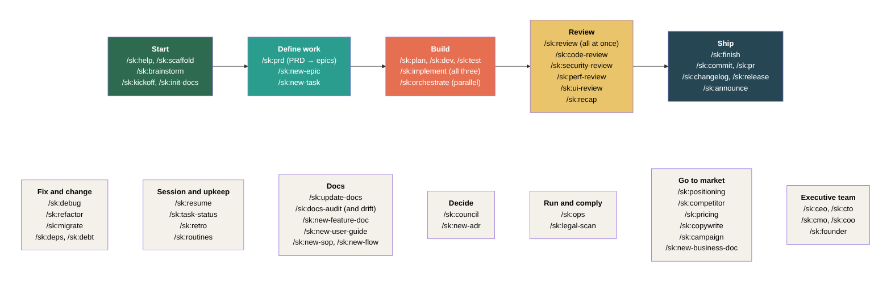

# SK — Moni's Software Machine

**How to go from idea to production, and keep a large codebase under control, with a disciplined workflow and processes that Claude Code follows every time.**

SK is a Claude Code plugin. An idea goes in; what comes out is a PRD that has been argued with, epics cut from it, a Plan > Dev > Test lifecycle with proof at every gate, and a documentation tree the agent reads before it writes a line and keeps current as the code grows. The same machine runs the rest of the company: reviews, releases, operations, marketing, an executive team, and routines that work while nobody is watching.

55 slash commands, 28 skills and 9 agents, installed once per machine. Your project keeps only `docs/` and `CLAUDE.md`.

```bash
claude plugin marketplace add moniav/sk && claude plugin install sk@shipkit
```
Then in any project: `/sk:scaffold`, and `/sk:prd` for your first idea.

## Why This Exists

Claude Code works dramatically better when it has structured context: your conventions, your architecture, your procedures, and a clear statement of what it is building. Without it you get inconsistent style, forgotten edge cases, scope drift, and the same mistakes in every session.

SK fixes that at three points:

1. **Before anything is built.** `/sk:prd` grills an idea until it is precise: the problem has to pass a check, every user flow is walked and attacked step by step, requirements get numbers, the architecture is challenged and its hard-to-reverse decisions become ADRs. Only then are epics cut, each tracing its requirements.
2. **While building.** A Plan > Dev > Test lifecycle with exit gates, subtasks capped at single-concern size, and guardrails on how the agent thinks: surface assumptions, do exactly what was asked, keep it simple, verify with evidence, track deliberate shortcuts.
3. **Between sessions.** A documentation tree the agent reads first and updates in the same commit as the code, so nothing is relearned: conventions, system state, decisions, flows, a glossary, and `/sk:resume` to pick up where you left off.

**Beyond engineering.** The same discipline covers the rest of a software company: end-user guides, business and GTM (positioning, competitors, pricing, campaigns), legal and compliance, operations (runbooks, incidents, postmortems), an executive team you meet 1:1, headless routines, document lifecycle tracking, a read-only coherence audit and one-command PDF export.

## What You Get

Two places, one system:

```
Claude Code plugin cache (installed once, updated by Claude Code)
├── commands/sk/        55 slash commands: /sk:prd, /sk:plan, /sk:dev, /sk:test, /sk:review, ...
├── agents/             9 agents: implementer, six reviewers, dependency-analyzer, debugger
├── skills/             28 skills: TDD, verification, escalation, flow design, architecture, legal, ops, ...
└── cli.mjs             the script behind /sk:scaffold

your-project/ (created by /sk:scaffold; yours to edit and commit)
├── CLAUDE.md                    the agent reads this first (under 100 lines)
└── docs/
    ├── START-HERE.md            human front door, by role
    ├── README.md                agent index
    ├── prd/                     PRDs: brief, user flows, requirements, architecture, epics
    ├── tasks/                   the board: epics, tasks, .current pointer
    ├── system/                  current state: stack, schema, APIs, integrations, glossary
    ├── architecture/ flows/     design, components, user and system flows
    ├── conventions/ sop/        how to work here: standards, procedures, delegation policy
    ├── decisions/               ADRs and the decision log
    ├── features/ user-guides/   what each feature does; customer-facing guides
    ├── business/ legal/ operations/   GTM, compliance, runbooks and postmortems
    ├── reviews/ research/ reference/ _archive/
    ├── templates/               27 starter templates, one per doc type
    └── commands-reference.md    the full command table, loaded on demand
```

Nothing of SK's is copied into `.claude/`, so a plugin update never touches your project, and `/sk:scaffold update` refreshes the shipped docs without overwriting a file you edited.

## How It Works



**LIFECYCLE** = how work flows from idea to done (PRD > epics > Plan > Dev > Test)
**WHAT** = what the system looks like (architecture, current state, features, flows)
**HOW** = how to work in and run it (coding rules, procedures, runbooks)
**WHY** = why things are the way they are (decision records)
**AUDIENCES** = who else the docs serve (customers, business and GTM, legal and compliance)

## From Idea to Shipped

```
new product:    /sk:prd (product) → /sk:kickoff   ┐
existing code:  /sk:init-docs → /sk:prd (feature) ├→ /sk:plan → /sk:dev → /sk:test → /sk:finish
one task:       /sk:new-task                      ┘
```

One command owns each step, and none asks a question another already answered. `/sk:brainstorm` comes before any of them when the direction itself is still open. The flow, with what each stage writes, is in [docs/flows/idea-to-epics.md](https://github.com/moniav/sk/blob/main/docs/flows/idea-to-epics.md).

### Task Lifecycle

Every piece of work flows through three phases with explicit exit gates:



**Quick Path (XS/S):** most work needs no task file. Describe what you want; for multi-step work Claude Code states a short plan with a check per step, does it, and suggests `/sk:commit` when done.

**Formal lifecycle (M and up):** a task file, each phase with its exit gate, and evidence recorded at the end: what was run, what it showed, at which revision.

### Task Hierarchy



A PRD covers a product or a feature big enough to need several epics. Epics link back to it (`prd: PRD-N`), tasks name the requirements they deliver (`delivers: FR-3`), subtasks are capped at single-concern size. Task files for a later epic are written when that epic starts, so they are planned against the code as it is then.

### What Keeps the Work Honest

- **Requirements stay delivered.** `/sk:finish` will not close an epic or mark a PRD delivered while a Must requirement has no finished task or an unproven criterion. `/sk:dev` never loosens a criterion that traces to a PRD; it points you to `/sk:prd PRD-N amend`.
- **A behaviour contract per feature.** Each feature doc lists what the feature promises, as Given / When / Then rows keyed by the requirement they came from. A PRD tags every flow and requirement ADDED, MODIFIED or REMOVED, and when the PRD is delivered `/sk:finish` applies those changes to `docs/flows/` and the contracts, then checks the result.
- **Docs that say what they were checked against.** Docs that describe code carry `Verified at: <commit>`. `/sk:docs-audit drift` asks git what changed since that commit and re-checks only the claims that cite those files: a renamed route, a dropped table, removed behaviour that is still served.
- **Reviews that find what matters.** `/sk:review` checks a small change in one pass and sends its reviewer agents only for larger ones. `/sk:review`, `/sk:code-review` and the quality reviewer look for callers outside the diff that a change breaks and flag a lowered bar (a skipped test, a new suppression, a loosened config), and every finding comes with a realistic trigger. The report-only commands never edit your code, even when told to.
- **Lessons that stick.** `/sk:retro` turns a finding that recurs across reviews into one row of project anti-patterns in your code-style conventions, which the quality reviewer reads. `/sk:plan` reads similar finished tasks first and checks their claims against today's code.

## Installation

```bash
# Once per machine:
claude plugin marketplace add moniav/sk
claude plugin install sk@shipkit
```

Then, once per project, in Claude Code:

```
/sk:scaffold              # creates docs/ and CLAUDE.md
/sk:scaffold --minimal    # core doc homes only; the rest are created on demand
```

The scaffold only fills gaps: it never replaces a file you already have. It runs a script that ships inside the plugin, so the docs always match the plugin's version. It needs Node.js 18 or later.

To share SK with everyone working in a repository, run `claude plugin marketplace add moniav/sk --scope project` there once and commit the `.claude/settings.json` it writes.

Full walkthrough: [plugin install guide](https://github.com/moniav/sk/blob/main/docs/user-guides/install-as-plugin.md).

**Where it runs.** The whole plugin loads in the Claude Code CLI and in Cowork. In the Claude web and desktop chat, the skills and commands load but the agents do not, so the review, implement and orchestrate commands that dispatch agents work in the CLI and Cowork only.

### Coming from SK 2.x (copied files)

Until 2.4.0, `npx shipkit-cld` copied the commands, skills and agents into the project's `.claude/`. That channel is gone: the plugin is the only install. In such a project, install the plugin, then run `/sk:scaffold migrate`: it removes the copied SK files (your own agents, skills and every doc are kept) and `/sk:scaffold update` then refreshes the shipped docs. The `shipkit-cld` npm package is no longer published.

## Updating

- `claude plugin update sk@shipkit` updates the commands, skills and agents. Or turn on auto-update for the `shipkit` marketplace under `/plugin` → Marketplaces (off by default).
- `/sk:scaffold update` in a project refreshes the shipped docs: templates, SOPs, reference docs, `docs/README.md`, `docs/commands-reference.md`, `docs/conventions/coding-behavior.md`, and `CLAUDE.md` while SK created it and you have not edited it.
- Then `/sk:update-docs` brings your own docs up to date: it re-checks them against the code and adds what a release introduces there, such as the `Verified at` stamps and the architecture sections in 3.2.0. `/sk:init-docs` is only for a project SK has not documented yet.

The docs update works one file at a time and **never overwrites your work**:

- **Project content is not touched:** PRDs, tasks, conventions, system docs, architecture, decisions, flows, features.
- **A shipped doc you edited is kept.** SK's new version is written beside it as `<name>.sk-new`. Merge what you want and delete the sidecar, or rename the sidecar over the file to take SK's version.
- **Your own files are left alone**, including one that shares a name with a doc SK ships.
- **`CLAUDE.md` is yours.** If you already have one when you scaffold, SK drops its template alongside as `CLAUDE.sk.md` for you to merge. If SK created it, updates refresh it only until you edit it.

`/sk:scaffold update` shows a dry run first. To take SK's version of every shipped doc, discarding edits, ask for `--force`; or ask Claude to merge each `.sk-new` into its file.

To customise SK without creating update work, put project-specific rules in files SK never manages (`docs/conventions/`, `docs/business/brand-voice.md`, and your own skills and agents under their own names) rather than editing shipped files. To change a command itself, fork the plugin: `claude --plugin-dir /path/to/your/fork/pkg` loads it from a directory.

## Models and cost

Commands and skills run in your session, on whatever model you chose. SK never switches it.

Subagents are set by role:

| Role | Agents | Model |
|------|--------|-------|
| Judgement-heavy | `debugger`, `architecture-reviewer`, `plan-reviewer` | your session's model |
| Bounded | `implementer`, `quality-reviewer`, `security-reviewer`, `perf-reviewer` | `sonnet` |
| Mechanical | `spec-reviewer`, `dependency-analyzer` | `haiku` |

A subtask that fails review twice is retried one tier up, and the subtasks of a small task may start on `haiku`.

To change this:

- **One model for every SK agent:** set `CLAUDE_CODE_SUBAGENT_MODEL=sonnet` and `CLAUDE_CODE_SUBAGENT_MODEL_FORCE=1`. Without the second variable, an agent's own setting wins.
- **A cheaper session with a stronger model on call:** use Claude Code's advisor setting.

The names are aliases. On Amazon Bedrock, Google Cloud and Microsoft Foundry they resolve to older models than on the Anthropic API unless you pin them.

## Getting Started

The setup path depends on whether code exists yet.



### Greenfield Project (starting from scratch)

```
1. Install SK (see Installation above)
2. /sk:prd                                  # Grill the idea into a PRD: brief, flows, architecture, epics (creates the docs/ scaffold if missing)
3. /sk:kickoff                              # Stack research, conventions, build commands, repo scaffold, from the PRD's stack
4. /sk:plan                                 # Plan the first task of EPIC-1, then /sk:dev, /sk:test, /sk:finish
```

`/sk:prd` decides what you're building and which stack it needs. `/sk:kickoff` then **researches current best practices** for that stack (latest versions, recommended project structure, naming conventions, common pitfalls) and generates all foundation docs automatically:

- `docs/system/tech-stack.md` — with current stable versions from research
- `docs/system/project-context.md` — dense project summary
- `docs/conventions/code-style.md` — conventions for your chosen language/framework
- `docs/conventions/file-structure.md` — recommended project layout
- `docs/conventions/testing.md` — test patterns for your stack
- `CLAUDE.md` Build Commands — filled in for your stack
- ADRs for your major stack choices

When you are not sure what to build, `/sk:brainstorm` comes first: it explores the problem from many angles and ends with one direction and a brief that `/sk:prd` picks up.

`/sk:prd` challenges the problem and success metric, walks every user flow and attacks each step (bad input, empty state, limits, permissions, failures, concurrency, RTL), offers clickable prototypes of the key flows, designs the architecture and questions each decision, writes ADRs for the hard-to-reverse ones, and only then cuts the PRD into epics.

**No manual file editing required.** Both commands work through conversation and write the files themselves.

### Brownfield Project (existing codebase)

```
1. Install SK (see Installation above)
2. /sk:init-docs                            # Auto-scan codebase, detect build commands, populate docs
3. Review generated docs                    # Verify accuracy, fix anything wrong
4. /sk:prd <feature>                        # A feature with new flows: scoped PRD, then its epics
   (or /sk:new-task for a single piece of work)
5. /sk:plan, /sk:dev, /sk:test, /sk:finish  # Build it (/sk:implement runs the three phases in one go)
```

`/sk:init-docs` reads the code in any of ten ecosystems (JavaScript and TypeScript, Python, Go, Rust, Java and Kotlin, .NET, Ruby, PHP, Elixir, Swift), finds every package in a monorepo, and generates:
- `docs/system/tech-stack.md` — per package, from the manifests
- `docs/system/project-context.md` — dense project summary
- `docs/system/database-schema.md` — from models and migrations
- `docs/system/api-reference.md` — from route declarations, each citing `path:line`
- `docs/conventions/code-style.md` — from observed naming and formatting patterns
- `docs/conventions/file-structure.md` — from actual project layout
- `docs/architecture/README.md` — components, a reading order for newcomers, the most-used modules, and anything it did not cover
- `docs/flows/` — one file per user-facing flow found in the code, and `docs/system/glossary.md` with the terms the code uses: the baseline a feature PRD compares against
- ADRs for 2-3 major tech choices it discovers

Where to look in each ecosystem lives in `docs/reference/stacks/signals.md`; add rows for a stack it does not know. Above about 150 source files it reads the code in chunks with read-only subagents and reports how many files it read in full. It never opens `.env` or key files, and writes variable names only.

**Build commands are auto-detected** from `package.json` scripts, `Makefile` targets, `pyproject.toml` tools, `Cargo.toml`, `go.mod`, and CI workflows. You only need to fill in commands marked `[NOT DETECTED]`.

**Already documented by SK?** Skip `/sk:init-docs`. `/sk:update-docs` re-checks your docs against the code and stamps each one it verified, and `/sk:docs-audit drift` lists exactly the claims the code has broken since.

### Autonomous & Multi-Agent Operation

SK works unattended and at fleet scale, governed by files you control:

- **`docs/conventions/delegation-policy.md`** — a decision-rights matrix defining what
  agents may do alone (commit, push, PR) vs ask (merge) vs never (deploy, publish,
  spend). Agents cannot widen their own authority.
- **`/sk:routines`** — schedule maintenance (doc audits, dependency sweeps, retros,
  security reviews) that runs headless: no questions, dated reports, escalation via
  the task board. See the [autonomous routines guide](https://github.com/moniav/sk/blob/main/docs/user-guides/set-up-autonomous-routines.md).
- **Task claiming + goals** — multiple agents pull from one board without collision
  (`claimed_by` frontmatter), prioritized against stated goals (`docs/business/goals.md`),
  with every autonomous decision journaled in `docs/decisions/decision-log.md`.
  See the [multi-agent guide](https://github.com/moniav/sk/blob/main/docs/user-guides/run-multiple-agents.md).

### Session Continuity

SK tracks your active work across sessions:

- **`docs/tasks/.current`** — automatically updated by lifecycle commands with your active task, phase, and subtask progress
- **Session briefing** — when a task is active, SK adds a short note at session start and after `/clear` or `/compact`: the task, its phase and the next subtask. It never resumes work on its own. Set `SK_SESSION_BRIEF=off` to turn it off.
- **`/sk:resume`** — the full picture: where you are, where you are going, what was learned and what was done, with the newest proof
- **Claude Code memory** — user preferences and workflow patterns persist across sessions automatically

## Command Map



## Command Reference

Not sure which command you need? Run `/sk:help`, or `/sk:help <what you want to do>`.

Claude starts only six commands by itself: `/sk:debug`, `/sk:resume`, `/sk:task-status`, `/sk:new-task`, `/sk:plan` and `/sk:review`. Every other command runs when you type it, so nothing commits, pushes or publishes unless you ask.

### Getting Started

| Command | Purpose | When to Use |
|---------|---------|-------------|
| `/sk:help` | Find the right command for a situation | Not sure where to start, or what comes next |
| `/sk:scaffold` | Create `docs/` and `CLAUDE.md`; `update` refreshes the shipped docs; `migrate` removes files an SK 2.x install copied | Once per project |
| `/sk:kickoff` | Engineering foundation: stack research, conventions, build commands, repo scaffold | After `/sk:prd` on a greenfield project |
| `/sk:brainstorm` | Explore a problem from many angles, leave with one direction and a brief | Not sure yet what to build |
| `/sk:prd` | Grill an idea into a detailed PRD (problem, flows, architecture), then cut epics | A new product or a feature big enough for several epics |
| `/sk:init-docs` | Auto-scan codebase, populate docs | Brownfield project or full rebuild |

### Lifecycle (Plan > Dev > Test)

| Command | Purpose | When to Use |
|---------|---------|-------------|
| `/sk:implement` | Full lifecycle: Plan > Dev > Test | Build a feature end-to-end |
| `/sk:plan` | Complete PLAN phase | Break down and prepare a task |
| `/sk:dev` | Execute DEV phase | Implement subtasks for a task |
| `/sk:test` | Execute TEST phase | Verify acceptance criteria |
| `/sk:finish` | Review + commit + push + PR + task update | After work is done, ready to ship |
| `/sk:orchestrate` | Parallel agent team — dependency-aware | 3+ independent subtasks, want parallelism |

### Decision Making

| Command | Purpose | When to Use |
|---------|---------|-------------|
| `/sk:council` | Multi-persona advisory council (3-5 personas, structured debate) | Architecture decisions, strategy, trade-offs |

### Document Creation

| Command | Purpose | Output |
|---------|---------|--------|
| `/sk:new-task` | Create a new task file | `docs/tasks/TASK-{N}-*.md` |
| `/sk:new-epic` | Create a new epic + child tasks | `docs/tasks/EPIC-{N}-*.md` |
| `/sk:new-sop` | Create a standard operating procedure | `docs/sop/*.md` |
| `/sk:new-adr` | Record an architecture decision | `docs/decisions/*.md` |
| `/sk:new-flow` | Create a flow diagram (SVG or Mermaid) | `docs/flows/*.svg` or `*.md` |
| `/sk:new-feature-doc` | Document a feature/subsystem, verified against code | `docs/features/*.md` |
| `/sk:new-user-guide` | Write a customer-facing, task-oriented guide | `docs/user-guides/*.md` |

### Quality & Review

| Command | Purpose | Output |
|---------|---------|--------|
| `/sk:review` | Security, performance and quality in one review: one pass for a small change, parallel reviewer agents for a larger one | Report with a ship/no-ship verdict |
| `/sk:code-review` | Analyze code for bugs, conventions, quality | Report (conversation) |
| `/sk:security-review` | OWASP Top 10, secrets, dependency audit | Report (conversation) |
| `/sk:ui-review` | Accessibility, responsive design, UX | Report (conversation) |
| `/sk:perf-review` | Queries, memory, rendering, caching | Report (conversation) |
| `/sk:recap` | Reviewer-facing recap of a diff — what changed and why | Report (conversation, optional save) |

### Debugging & Refactoring

| Command | Purpose | Output |
|---------|---------|--------|
| `/sk:debug` | Reproduce, isolate, fix, verify with regression test | Code fix + test + task file (M+) |
| `/sk:refactor` | Restructure code, verify behavior unchanged | Code changes + task file (M+) |
| `/sk:migrate` | Handle breaking changes, dependency upgrades, DB migrations | Safe migration with rollback plan |
| `/sk:debt` | Harvest `sk-debt` markers into a ranked ledger | Tech-debt ledger (optional save) |

### Git & Release

| Command | Purpose | Output |
|---------|---------|--------|
| `/sk:commit` | Smart git commit + push + PR | Git commit |
| `/sk:pr` | Create a pull request from the current branch | PR URL |
| `/sk:changelog` | Generate changelog from git history | `CHANGELOG.md` |
| `/sk:release` | Version bump + changelog + tag + GitHub release | Tagged release |

### Session & Management

| Command | Purpose | When to Use |
|---------|---------|-------------|
| `/sk:resume` | Session briefing + context restore | Starting a new session with active work |
| `/sk:task-status` | Show task board overview | Check progress across all tasks |
| `/sk:update-docs` | Sync docs with codebase | After changes, or periodic audit |
| `/sk:docs-audit` | Audit doc coherence — orphans, staleness, broken links, lifecycle, and drift from the code since each doc was verified (`drift` runs only that) | Periodic doc health check, before release, after merges |
| `/sk:ops` | Operations/SRE expert — incidents, runbooks, postmortems, SLOs, readiness | Running prod, on-call, reliability work |
| `/sk:deps` | Dependency health check | Periodic audit or before release |
| `/sk:retro` | Run a retrospective on completed work | Capture lessons, patterns, improvements |
| `/sk:routines` | Scheduled maintenance routines — headless, policy-governed | Automating audits, retros, dependency sweeps |

### Marketing, GTM & Legal

| Command | Purpose | When to Use |
|---------|---------|-------------|
| `/sk:copywrite` | Write marketing copy — landing pages, emails, ads, CTAs, blog posts | Any SaaS/tech marketing copy task |
| `/sk:campaign` | Plan, track, and close marketing campaigns — goal-linked, honest results | Coordinated marketing work |
| `/sk:announce` | Turn a release into an announcement pack (post, email, social) | After `/sk:release` |
| `/sk:positioning` | Define positioning & messaging (ICP, category, value prop) | Establishing GTM foundation |
| `/sk:competitor` | Analyze competitors — profiles, positioning map, comparison | Competitive intelligence |
| `/sk:pricing` | Design or evaluate pricing — value metric, model, tiers | Pricing decisions |
| `/sk:new-business-doc` | Create a business doc (plan, model, cap table, update, memo) | Capturing a business artifact |
| `/sk:legal-scan` | Legal & compliance expert — requirements, framework deep-dives, document drafting, contract review | Starting a project, adding payments, fundraising |

Full marketing walkthrough (brand voice → copy → campaigns → announcements → routines): [Run your marketing with SK](https://github.com/moniav/sk/blob/main/docs/user-guides/run-your-marketing.md).

### Executive Team

Run the company with an executive team — persistent 1:1 partners with portfolios,
memory (each seat keeps a `STATE.md` + meeting notes in its office), a dissent duty,
and authority that widens only on cited evidence. The founder is **never gated**:
every command keeps working directly, and executives observe your work rather than
approving it.

| Command | Purpose | When to Use |
|---------|---------|-------------|
| `/sk:ceo` | Strategy, goals, roadmap — plus `grill` (stress-test with memory) and `product` (proceed/park/kill verdicts) | Strategy sessions, feature decisions |
| `/sk:cto` | Architecture, quality, velocity, debt — feasibility lens | Technical direction, tech health |
| `/sk:cmo` | Positioning, brand, campaigns, launches — marketability lens | Marketing direction |
| `/sk:coo` | Routines, incidents, reliability — "runs the same when nobody watches" | Operational health |
| `/sk:founder` | The Monday packet: briefs merged into an approval console, decisions ranked one-way-doors-first | Weekly founder review |

Weekly headless briefs via `/sk:routines`; per-seat decision rights live in your
`docs/conventions/delegation-policy.md`. Custom seats via the `executive-charter`
template. Full walkthrough: [Meet your executive team](https://github.com/moniav/sk/blob/main/docs/user-guides/meet-your-executive-team.md).

## Repository Structure

`pkg/` is the plugin root and the only thing that ships; everything else is for developing SK. To work on SK, run `npm run dev`: it starts Claude Code with the plugin loaded from `pkg/`, and `/reload-plugins` picks up edits.

```
sk/                              ← SK source repository
├── CLAUDE.md                    ← SK development instructions (NOT shipped)
├── .claude-plugin/              ← marketplace.json: installs the plugin from ./pkg
├── scripts/                     ← Dev tooling (check, evals), not shipped
├── package.json                 ← Private: version, npm test, npm run dev (claude --plugin-dir ./pkg)
├── pkg/                         ← The plugin root: everything that ships
│   ├── cli.mjs                  ← The script behind /sk:scaffold: init, update (docs), migrate
│   ├── .claude-plugin/          ← plugin.json
│   ├── CLAUDE.md                ← Template CLAUDE.md installed into projects
│   ├── docs/                    ← Template documentation tree
│   └── .claude/                 ← Commands, agents, skills
│       ├── commands/sk/         ← 55 slash commands
│       ├── agents/              ← 9 agents: implementer, six reviewers, dependency-analyzer, debugger
│       └── skills/              ← 28 skills: 12 the model fires itself (TDD, verification, escalation, ...), the rest loaded by commands (research, interviewing, product-brief, flow-design, architecture-design, prototype, ...)
└── docs/, dev-docs/             ← SK's own docs (dogfood instance) and planning notes, not shipped
```

## Key Design Decisions

**Plan > Dev > Test lifecycle** — Forces thinking before coding. Each phase has an explicit exit gate so nothing gets skipped. The 3-phase cycle is simple enough to actually follow.

**Quick Path as default** — Most work is XS/S complexity. The formal lifecycle exists for M+ work but the default is "just do it" with mental guardrails.

**Lazy-loaded context** — Commands only read the docs they need for the current phase, not everything upfront. This keeps context windows lean and response times fast.

**PRD before epics** — A product or a multi-epic feature is grilled first: the problem statement has to pass a check, every user flow is walked and attacked step by step (bad input, empty state, limits, permissions, a dependency down, concurrency, RTL), requirements get numbers, the architecture is challenged and its hard-to-reverse decisions become ADRs. Epics are cut from the approved PRD, each tracing its requirements. Key flows can be prototyped as clickable variants before a line of production code exists.

**One owner per step** — `/sk:brainstorm` picks a direction, `/sk:prd` defines it, `/sk:kickoff` or `/sk:init-docs` lays the engineering foundation, the lifecycle commands build it. No command asks a question another one already answered.

**Task hierarchy (Epic > Task > Subtask)** — Epics break into tasks, tasks break into subtasks. Each level has a clear scope and complexity ceiling. Subtasks capped at S complexity (single concern) prevent scope creep and make progress visible.

**Self-contained tasks** — Every task is independently buildable, testable, and shippable. Claude Code can execute a task without needing context from other in-flight work.

**Worked examples over abstract docs** — The `examples/` folder shows exactly what a completed task looks like. Worth more than pages of explanation.

**Templates over empty files** — Every doc type has a template whose placeholders say what good looks like, and the commands that fill them read the same section names.

**SVG + Mermaid for diagrams** — SVG diagrams (via the `technical-diagrams` skill) for polished architecture and flow visuals with a consistent design system. Mermaid for quick sequences, ER diagrams, and state charts that render natively in GitHub. Both live in git alongside code.

**ADRs for decisions** — "Why did we choose X?" is the most expensive question in a codebase. ADRs answer it once.

**SOPs for procedures** — AI agents follow explicit steps better than vague guidelines. SOPs eliminate improvisation on critical tasks.

**Parallel orchestration** — `/sk:orchestrate` analyzes subtask dependencies, builds a file-conflict graph, groups independent subtasks into waves, and dispatches parallel subagents with worktree isolation. Two-stage review (spec + quality) runs per agent. Merges wave results sequentially with conflict detection. Caps at 4 parallel agents per wave and checks usage between waves.

**Advisory council** — `/sk:council` convenes 3-5 AI personas with genuinely incompatible value systems (pragmatist vs architect vs adversary) to debate strategic questions. Structured rounds: independent positions (zero cross-visibility), challenge, optional rebuttal, synthesis. Produces a decision report with recommendation, confidence, dissent, and conditions for reversal. A plan-arbiter mode resolves competing plans via a ranked tiebreaker instead of blending them.

**Behavioral guardrails** — LLMs over-engineer, make hidden assumptions, and drift from scope. Five principles (surface assumptions, do exactly what's asked, keep it simple, verify with evidence, track deliberate shortcuts via `sk-debt` markers) are embedded in every lifecycle command to counteract this. See `docs/conventions/coding-behavior.md`.

**Proof over claims.** Every phase gate ends on something that can be shown: a command that was run with its output, a file that exists, a count that matches. Each acceptance criterion is reported as passed, failed or untested, never left out. Reviewer findings say how far they were proven.

**Updates never destroy your work.** Commands, skills and agents update as a plugin bundle, outside the project. The shipped docs update one file at a time: a file you edited is kept, with SK's new version written beside it; a file of yours that shares a name with one of SK's is never touched.

**Context is a budget.** A command or skill that Claude can start by itself puts its description in every turn. Only six commands and twelve skills do; the rest run when you type them. Three behaviour rules that used to depend on a skill firing (evidence before "done", stop after three failed attempts, what "just do it" permits) are always on through `CLAUDE.md`.

## How SK Is Tested

`npm test` checks every command, skill and agent for the failures Claude Code does not report: unknown frontmatter keys, paths that do not resolve, counts that disagree, commands the model could start by itself, files over the size limit. It also runs the scaffold's install, update and migrate against fixtures, and breaks each rule in a copy to prove the check catches it.

Behaviour is measured with `claude plugin eval`. Each case builds a small repository, runs a command with and without the plugin, and a judge scores the result. Some of the cases (Sonnet, three runs each):

| Case | Without SK | With SK |
|------|-----------|---------|
| `/sk:dev` is asked to loosen a criterion that traces to a PRD | 0% | 100% |
| A report-only review is told to "just fix it" | 50% | 100% |
| `/sk:finish` delivers a PRD that adds, changes and removes behaviour | 33% | 100% |
| `/sk:docs-audit drift` finds a renamed route, a dropped table and removed behaviour still served, and nothing else | 0% | 100% |

`/sk:review` costs about half what it did before the one-pass path, at the same scores. Where SK does not help yet: told there is no time for tests or verification, the agent skips them as often with SK as without. The cases and baselines are in `dev-docs/evals/`.

## Anti-Patterns to Avoid

| Don't | Do Instead |
|-------|-----------|
| Write 20-page architecture docs | Keep each doc focused, link between them |
| Document implementation details | Document decisions and interfaces |
| Let docs go stale | Update in the same PR as the code change |
| Duplicate content across docs | Link to the single source of truth |
| Write docs nobody reads | Write docs Claude Code reads every session |
| Add features "while you're in the file" | Stick to the task scope, note improvements as follow-ups |
| Build for hypothetical future needs | Implement the simplest thing that satisfies the acceptance criteria |
| Mark criteria as "works" or "done" | Verify with specific evidence ("returns 201 with {id, email}") |
| Start an epic from a one-line idea | Run `/sk:prd` first; let the flows and the architecture decide the epics |
| Write "handle errors" in a spec | Decide the message, the recovery path and what is preserved, per step |

## Credits

SK stands on other people's work. Each borrowed piece carries a credit line in its file; this is the list.

| Source | License | What SK took from it |
|--------|---------|----------------------|
| [mattpocock/skills](https://github.com/mattpocock/skills) | MIT | `grilling` → the `interviewing` skill (design tree, frontier, rounds with a recommended answer, facts versus decisions); `domain-modeling` → the glossary discipline and the three-gate ADR test in `architecture-design`; `wayfinder` → writing later epics' tasks only when they start; its plugin layout and invocation rules shaped SK's |
| [RefoundAI/lenny-skills](https://github.com/RefoundAI/lenny-skills) (`writing-prds`) | MIT | the `product-brief` skill: the brief fields, the five-attribute problem-statement check, non-goals, appetite, the warning against the word "just" and premature high-fidelity mocks |
| [emilkowalski/skill](https://github.com/emilkowalski/skill) | MIT | `prototype` → the `prototype` skill (divergent variants on a named axis behind a picker); `break-ui` → the worst-case data list used by `prototype` and `flow-design` |
| [cursor/plugins (pstack)](https://github.com/cursor/plugins/tree/main/pstack) | MIT | `unslop` → the plain-writing rules in `technical-writing`; the evidence ladder in `verification-before-completion` and `/sk:test`; blinded evals; transcript lenses in `/sk:retro` |
| [michaelshimeles/skills](https://github.com/michaelshimeles/skills) | MIT | the worktree flow in `git-worktrees`; the evidence protocol merged into `verification-before-completion` |
| [The-PR-Agent/pr-agent](https://github.com/The-PR-Agent/pr-agent) | MIT | finding discipline in every review (what the change introduces, a realistic trigger, no style noise), the check pass before a report, task compliance, failure modes |
| [obra/superpowers](https://github.com/obra/superpowers) | MIT | reviewers that cannot be steered, the CANNOT_VERIFY verdict, the fix-round limit, the TDD excuses table, the lowered-bar check |
| [addyosmani/agent-skills](https://github.com/addyosmani/agent-skills) | MIT | the lowered-bar check, review integrity, working-behaviour rules, `npm test` guard rails |
| [affaan-m/ECC](https://github.com/affaan-m/ECC) | MIT | the lowered-bar check; rules for the session hook |
| [gotalab/cc-sdd](https://github.com/gotalab/cc-sdd) | MIT | the requirement coverage gate in `/sk:finish`, criteria `/sk:dev` may not change, failed attempts kept in Dev Notes |
| [Fission-AI/OpenSpec](https://github.com/Fission-AI/OpenSpec) | MIT | the behaviour contract and its ADDED / MODIFIED / REMOVED merge; behaviour drift in `/sk:docs-audit` |
| [OthmanAdi/planning-with-files](https://github.com/OthmanAdi/planning-with-files) | MIT | memory that survives compaction (Dev Notes, Progress Log, `next:`), the five questions in `/sk:resume`, rules for the session hook |
| [Egonex-AI/Understand-Anything](https://github.com/Egonex-AI/Understand-Anything) | MIT | architecture docs with a reading order, hubs and `path:line` evidence; drift since `Verified at` |
| [EveryInc/compound-engineering-plugin](https://github.com/EveryInc/compound-engineering-plugin) | MIT | the learning loop: recurring review findings become project anti-patterns, and `/sk:plan` reads past tasks |
| [DietrichGebert/ponytail](https://github.com/DietrichGebert/ponytail) | MIT | the one-pass path in `/sk:review`, the callers check, per-run cost in the evals |
| [multica-ai/andrej-karpathy-skills](https://github.com/multica-ai/andrej-karpathy-skills) | MIT | working-behaviour rules in the CLAUDE.md template and `coding-behavior.md` |
| [agent-sh/agnix](https://github.com/agent-sh/agnix) | MIT or Apache-2.0 | the silent-failure checks in `npm test` |
| [wshobson/agents](https://github.com/wshobson/agents) | MIT | the silent-failure checks in `npm test` |
| [anthropics/skills](https://github.com/anthropics/skills) | Apache-2.0 | the method for the trigger evals (`skill-creator`) |
| [microsoft/SkillOpt](https://github.com/microsoft/SkillOpt) | MIT | description tuning on held-out cases, keeping only strict gains |
| [mksglu/context-mode](https://github.com/mksglu/context-mode) | ideas only | filtering large output at the source; rules for the session hook |
| [thedotmack/claude-mem](https://github.com/thedotmack/claude-mem) | ideas only | rules for the session hook |
| [Graphify-Labs/graphify](https://github.com/Graphify-Labs/graphify) | Apache-2.0, ideas only | the secret-file skip list; the chunked scan for large repositories |
| [JuliusBrussee/caveman](https://github.com/JuliusBrussee/caveman) | Apache-2.0, ideas only | the chunked scan for large repositories |
| Higgsfield's SaaS landing page guide | not stated | the landing page reference and audit in `/sk:copywrite` |
| [benjitaylor/skills](https://github.com/benjitaylor/skills) (`stageshow`) | MIT | product visuals in the landing page reference, the interface detail and motion rows in `/sk:ui-review`, the reference comparison in `prototype` |

SK itself is MIT licensed (see [LICENSE](./LICENSE)).

