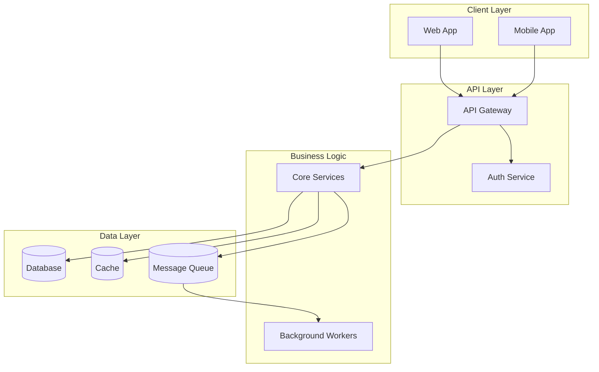

# Architecture

> System design, component relationships, and data flow patterns.

**Last updated:** YYYY-MM-DD

## Overview

<!-- High-level description of the system architecture -->

> [WARN] Replace the diagram above with your actual system architecture.

## Component Index

| Component | Doc | Owner | Status |
|-----------|-----|-------|--------|
| <!-- e.g. Auth Service --> | [Link](./auth-service.md) | - | Active |

## Reading Order

<!-- Where a newcomer (person or agent) starts: the entry points, then 5 to 10 files in the order to read them, following what each imports. One line each, with its path. -->

1. `path/to/entry`: what starts here

## Hubs

<!-- The 3 to 5 modules most imported or referenced across the source: change them with care. -->

| Module | Referenced by | Why it matters |
|--------|---------------|----------------|
| `path/to/module` | N files | - |

## Not Covered

<!-- Top-level source folders that belong to no component above, and why (generated, vendored, experimental). Every folder appears in exactly one component or here. -->

## Open Questions

<!-- What the code does not settle. Statements above cite `path:line` or are marked *(inferred)*. -->

## Key Design Principles

<!-- List 3-5 architectural principles that guide decisions -->

1. **Principle:** Description
2. **Principle:** Description

## Cross-Cutting Concerns

- **Authentication:** How auth works across services
- **Error Handling:** Standard error patterns
- **Logging:** Structured logging approach
- **Monitoring:** Observability strategy
